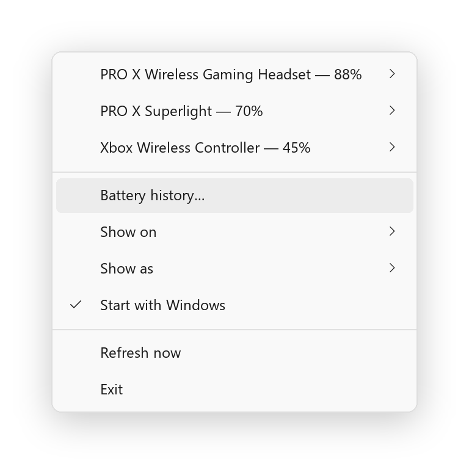
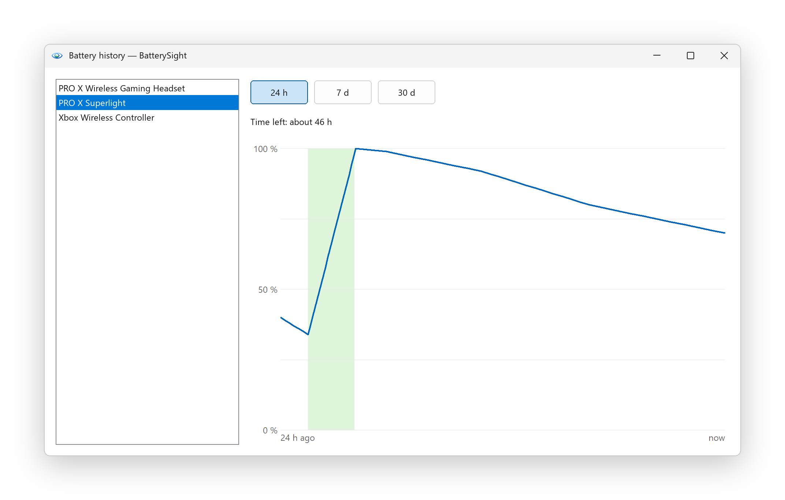

  

<h1 align="center">BatterySight</h1>

  <b>Battery levels for your wireless devices, right on the Windows taskbar.</b> 
  <a href="https://github.com/hani64/BatterySight/releases"><b>Download</b></a> · Windows 10 and 11 · Free and open source

  <picture>
    <source media="(prefers-color-scheme: dark)" srcset="assets/screenshots/hero-dark.png">
    
  </picture>

| | |
|---|---|
| **At a glance** | Every device's battery next to the clock. Hover for details, and get notified when one runs low. |
| **Lightweight** | One 1.3 MB file, about 7 MB of memory. No installer, no background service, no admin rights. |
| **Native** | Lives inside the taskbar, follows light and dark mode, uses Windows' own text rendering and notifications. |
| **Battery-friendly** | Listens for updates instead of asking every minute, so your devices still go to sleep. |
| **Private** | No account, no telemetry, never goes online. |

## Install

1. Download `batterysight-vX.Y.Z-x64.exe` from [Releases](https://github.com/hani64/BatterySight/releases) and run it. There is nothing to install.
2. If Windows SmartScreen warns you, choose **More info → Run anyway**. The file is not code-signed yet.
3. Click BatterySight on the taskbar and choose **Start with Windows**.

**Update:** exit it, replace the file, start it again. **Uninstall:** untick Start with Windows, exit, delete the file (and `%LOCALAPPDATA%\BatterySight` to remove its settings and history).

## Supported devices

| Brand | Devices | Status |
|---|---|---|
| Logitech | PRO X Wireless headset, PRO X Superlight | Tested |
| Logitech | Other wireless mice, keyboards and headsets on Logitech's protocol | Untested |
| Any brand | Bluetooth devices that Windows shows a battery level for | Tested |
| Microsoft | Xbox controllers on a USB cable | Tested |
| Microsoft | Xbox controllers on the Xbox Wireless Adapter | Untested |
| SteelSeries | Arctis Nova 7, Nova 5, Nova 3P/3X, Arctis 7+, GameBuds, Nova Pro Wireless, Nova Pro Omni, Nova Elite | Untested |
| HyperX | Cloud III, Cloud II Core, Cloud Alpha, Cloud Alpha 2 (Wireless), Pulsefire Haste 2 Wireless | Untested |
| Pulsar | Mice on Fusion2 1K/8K and Feinmann 8K dongles | Untested |
| Rapoo | VT7, VT2 Pro Max, VT9 Pro V2, VT1 SE, VT7 SE, VT9 Pro, VT3 Pro | Untested |

**Untested** devices are built from public protocol documentation but not yet tried on the hardware. Own one? Please [tell us how it goes](https://github.com/hani64/BatterySight/issues/new/choose). Missing yours? [Ask for it](https://github.com/hani64/BatterySight/issues/new/choose).

Exact models, USB ids and how each is read

`batterysight --list` shows each device's status: `hardware-tested` (on the maintainer's hardware, Windows 11 build 26300) or `source-verified` (built from public protocol sources, untested). The tested Logitech devices matched G HUB within 1 point (BatterySight rounds down). Other models of these brands are not supported, even with a similar name: a different PID often means a different protocol.

| Devices | Connection, VID:PID | How the level is kept up to date |
|---|---|---|
| Bluetooth devices with a Windows battery level (tested: Classic earbuds, Xbox controller over LE; speakers untested) | Bluetooth | Windows' cached value: at start, on connect (and 4 s and 15 s later), on resume, "Refresh now", every 60 s while connected. Icon from the Bluetooth class or HID type |
| Xbox controllers (tested: 045E:0B12) | USB cable | Windows' game-controller report (Full, Good, Low, Critical): when added, on resume, "Refresh now", every 60 s. Over Bluetooth it is a Bluetooth device; one moved between the two shows as one row |
| Xbox controllers | Xbox Wireless Adapter | As on a cable; untested |
| Logitech PRO X Wireless (tested) | USB dongle, 046D:0ABA | Device reports, plus the checks under [How it reads batteries](#how-it-reads-batteries) |
| Logitech PRO X Superlight (tested) | LIGHTSPEED receiver, 046D:C547 | Device reports |
| Other Logitech HID++ devices | Logitech receivers and USB, 046D | Device reports |
| SteelSeries Arctis Nova 7 family, incl. Gen 2 | Dongle, 1038: 2202, 2206, 220A, 223A, 227A, 22A4, 227E, 2258, 229E, 22AD, 22A1, 22A5, 22A7, 22A9, 2298, 22AB | Headset reports; asked 1.5 s after the dongle is found, on resume, "Refresh now", once on relink |
| SteelSeries Arctis Nova 5, 5X | Dongle, 1038: 2232, 2253, 2264 | As Nova 7 |
| SteelSeries Arctis Nova 3P, 3X Wireless | Dongle, 1038: 2269, 226D | As Nova 7 |
| SteelSeries Arctis 7+ family | Dongle, 1038: 220E, 2212, 2216, 2236 | As Nova 7 |
| SteelSeries Arctis GameBuds | Dongle, 1038: 230A | As Nova 7; the lower bud's level, no charging state |
| SteelSeries Arctis Nova Pro Wireless | Base station, 1038: 12E0, 12E5, 225D | Headset reports; asked 5 s after the station is found, on resume, "Refresh now", once on relink. Spare battery not shown |
| SteelSeries Arctis Nova Pro Omni | Base station, 1038: 2290 | As Nova Pro Wireless |
| SteelSeries Arctis Nova Elite | Base station, 1038: 2244, 2246, 2270 | As Nova Pro Wireless |
| HyperX Cloud III Wireless | Dongle, 03F0: 05B7, 0C9D, 0FCC | Headset reports; asked only when found, on resume, "Refresh now" (never during use: it would reset its auto power-off) |
| HyperX Cloud II Core Wireless | Dongle, 03F0: 0995 | As Cloud III |
| HyperX Cloud Alpha Wireless | Dongle, 03F0: 098D | As Cloud III, plus while sound is audible, at the "Check battery while in use" interval |
| HyperX Cloud Alpha 2 Wireless | Dongle, 03F0: 08BE | Asked at most once per link-up, only if it has not reported within 2 s |
| HyperX Pulsefire Haste 2 Wireless | Receiver, 03F0: 0F98 | As Cloud Alpha 2 |
| Pulsar Fusion2 1K, 8K | Receiver, 3710: 5402, 5403 | Mouse reports on link-up; asked when found, on resume, "Refresh now", once on a silent link-up, and while linked at the "Check battery while in use" interval (default 10 min, min 1 min) |
| Pulsar Feinmann 8K | Receiver, 3710: 5404 | Asked only when found, on resume, "Refresh now" |
| Rapoo VT7, VT2 Pro Max, VT9 Pro V2, VT1 SE, VT7 SE, VT9 Pro (1st gen, 185A), VT3 Pro | Receiver/cable, 24AE: 1413/4613, 1423, 14A9/46A9, 1A11/4A11, 1A00/4A00, 1205, 185A, 1215/4415 | Never asked: listens to the status the mouse sends while used; asleep after 60 s without one. No charging state |

## Using BatterySight

### The taskbar

| You see | It means |
|---|---|
| `88%` | Battery level. Red: at or below your low-battery alert |
| Lightning bolt | Charging |
| Check mark | Full, still on the charger |
| Dimmed | Asleep (last known level) |
| Dimmed × | Just disconnected; gone after about a minute |
| A short caption, such as `SUP` | Tells two devices of the same kind apart |

Hover over a device for its name, level, status ("Connected", "3 min ago", "Asleep") and an estimate of the time left. If the widget can't appear, BatterySight shows notification-area icons instead.

### The menu

  <picture>
    <source media="(prefers-color-scheme: dark)" srcset="assets/screenshots/menu-dark.png">
    
  </picture>

- **Each device:** show or hide it, move it, and set its low-battery alert (off or 5–40 %, default 15 %).
- **Check battery while in use:** for devices that stay quiet while in use (such as the PRO X Wireless), every 5–60 min (default 10), only while in use or charging.
- **Battery history, Show on** (which monitors), **Show as** (widget or tray icons), **Start with Windows, Refresh now, Exit.**

Details

- Low-battery notification: sent once when an awake, shown, unplugged device drops to its alert level; again after it charges or rises 10 points above it, after you change the level, or after a restart. Devices with only rough levels alert at Low or Critical. In widget mode a temporary tray icon carries it.
- "Check battery while in use": the device's minimum is the shortest offered (5 min for the PRO X Wireless, 1 min for a Pulsar Fusion2); a shorter value in `settings.toml` counts as the minimum. The first check after a wake or plug-in comes at the minimum.
- "Show as": a tray choice stays across restarts. When BatterySight switched to tray icons by itself, this menu says why; choosing the widget there retries it.
- "Start with Windows" uses `HKCU\Software\Microsoft\Windows\CurrentVersion\Run`. It shows unticked while Task Manager's Startup apps disables BatterySight; ticking it re-enables it there.
- One BatterySight runs per session; starting another does nothing.

### Battery history

  

Each device's level over 24 hours, 7 days or 30 days, with charging shaded and an estimate of the time left. Kept for 30 days, recorded only from readings it gets anyway.

Details

Gaps show where the device was asleep or off, or the PC was off. The time-left estimate uses the latest stretch of at least 2 hours of use without charging, sleep or a restart. A sample is recorded on any change and at most every 30 minutes otherwise; hidden devices are recorded too. For voltage-based devices (such as the PRO X Wireless), a reading taken as it wakes reads high on a rested battery and is left out of the chart when an in-use reading follows within 10 minutes.

## How it reads batteries

BatterySight listens for the updates devices send on their own. It only asks a device:

- when it starts, or the device is plugged in or reconnects,
- when your PC wakes up, or you choose **Refresh now**,
- for headsets that stay quiet while in use: every 10 minutes while sound plays on them or they charge.

It never changes your devices' settings, and it never records or plays audio: it only checks whether sound is playing on a headset.

The exact rules

Apart from turning on a Logitech receiver's device notifications, everything it sends is a battery or connection question. A plugged-in device that is busy before it is recognised is asked again after 2 s, 10 s and 60 s, then not until a resume or "Refresh now" (which also retries it). Headset checks during use happen only while sound actually plays and never while the headset is off or asleep; while it charges they continue without sound (and may delay its auto power-off on the charger). Opening the menu never asks; an asleep device is left alone until it reports.

Per brand: Rapoo mice, Bluetooth devices and Xbox controllers are never asked; SteelSeries headsets, HyperX Cloud III and Cloud II Core and the Pulsar Feinmann are not asked during use; HyperX Cloud Alpha 2 and Pulsefire Haste 2 only on link-up; the Cloud Alpha only while sound is audible; a Pulsar Fusion2 mouse only while its receiver reports it linked (the sources say reading it neither wakes nor keeps it awake). A headset's audio is matched through the container id Windows gives its audio endpoint and its HID interfaces; BatterySight only watches active audio sessions and the endpoint's peak meter.

## Known limitations

- **PRO X Wireless:** reports nothing while in use, so its level can lag during long silent stretches (a muted call).
- **Bluetooth:** only as fresh as Windows' own value; some LE devices update it only on reconnect. A device appears once it has connected since BatterySight started.
- **Xbox controllers:** four levels only. Over Bluetooth, only the Bluetooth level is shown.
- **Virtual controllers** (such as vJoy) can hide Xbox controllers on a cable or the adapter.
- **"Show on" one monitor:** if that monitor turns off and on, the widget stays on the main taskbar until a restart.

Open questions about untested devices (a report helps)

SteelSeries: events on Windows without SteelSeries GG, and the Nova Pro station's report sizes. HyperX: answers on every hardware revision with NGENUITY running, and how often Cloud Alpha and Cloud II Core report; link-up announcements on dongles never set up by NGENUITY (Alpha 2, Haste 2). Pulsar Feinmann: link-up announcements. Rapoo: charging state, and how often the VT1 SE and VT7 SE report.

## Troubleshooting

| Problem | Try |
|---|---|
| No widget on the taskbar | BatterySight switches to tray icons by itself and retries the widget later. To always use icons, start it with `--tray-only`. |
| A device is missing | Check the list above. Bluetooth devices must be connected. Choose **Refresh now**. |
| A level looks old | Choose **Refresh now**. Bluetooth and Xbox levels are as fresh as Windows' own. |
| Start with Windows won't stay on | Task Manager → Startup apps has BatterySight disabled; tick it again in the menu. |
| SmartScreen blocks it | **More info → Run anyway.** |
| Something else | Open a [bug report](https://github.com/hani64/BatterySight/issues/new/choose) with a trace: set `BATTERYSIGHT_TRACE=1`, reproduce, attach `%LOCALAPPDATA%\BatterySight\sends.log`. |

Command line and trace log

- `--tray-only`: tray icons instead of the widget.
- `--list`: prints the devices found (name, connection, level, charging, key, status, `asleep`) and exits, once readings settle for 5 s (10 s at most; 8 s at least with a SteelSeries base station). The key can be a device id.
- If the widget stops responding, BatterySight restarts itself with tray icons (after about 1.5 s, or 5 s if Explorer is busy) so it can't freeze the taskbar. It retries the widget after 15 s, 1 min and 5 min, and when Explorer restarts or displays or settings change.
- The trace log records every report sent and received with its bytes, refused or failed requests, audio activity, devices held back after rapid replugging or failing to open, discovery retries, tray-icon fallbacks, autostart and text-rendering problems, and settings or history file errors. It is off by default and contains device ids.

## Privacy

No account, no telemetry, no internet. Settings (`settings.toml`) and 30 days of history (`history.tsv`) stay in `%LOCALAPPDATA%\BatterySight`.

What the files contain

Both use device ids (such as unit ids) as keys. `settings.toml` also keeps each device's last seen name (which may be one you gave it) so the history can name it; names without history are removed at start. `history.tsv` has one line per sample: time, device, level, charging, awake/asleep/offline, millivolts when known, and the source. Lines it can't read and samples older than 30 days are removed at start; unreadable lines or samples dated more than a day ahead are first copied to `history.tsv.bad`.

## Contributing

Device testing, captures and fixes are welcome: see [CONTRIBUTING.md](CONTRIBUTING.md) for building, device tools and guidelines. Report security problems privately as described in [SECURITY.md](SECURITY.md).

## License

GPL-3.0-only. See [LICENSE](LICENSE).
